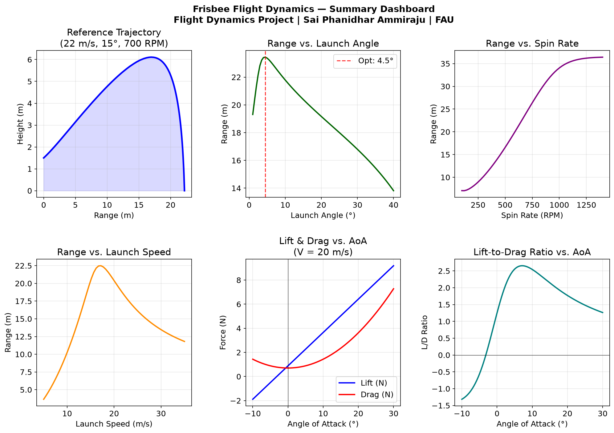
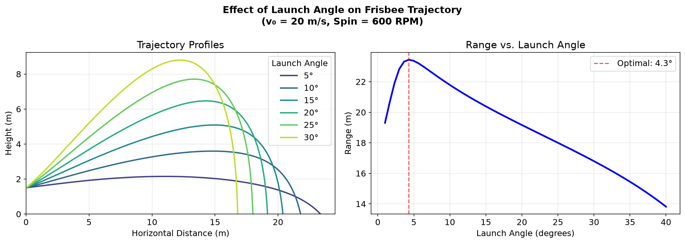
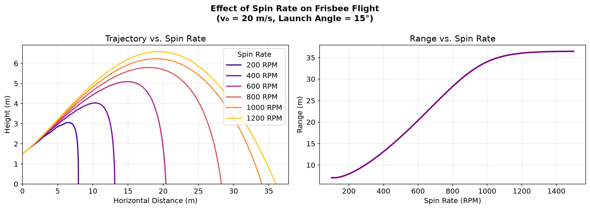
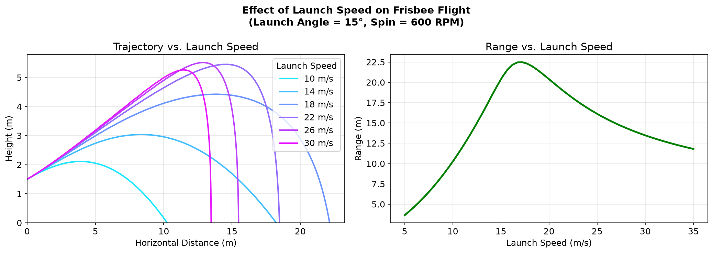
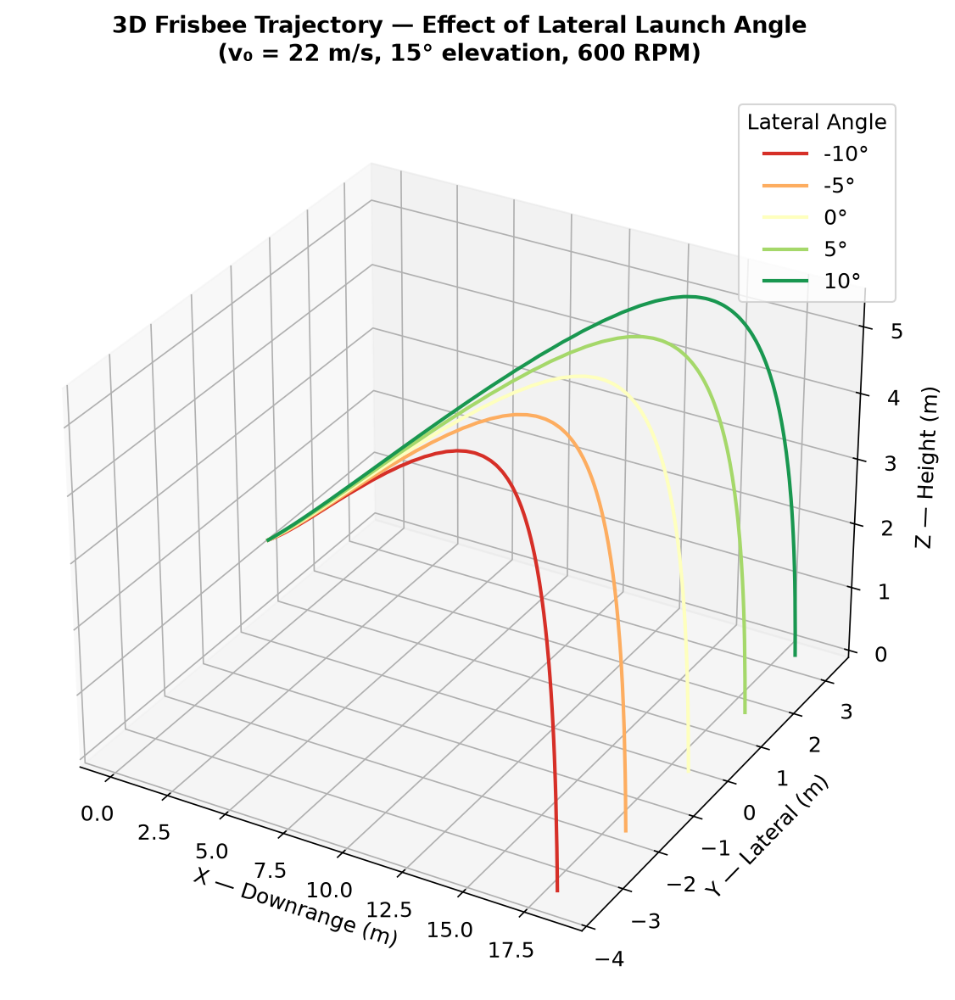

# Frisbee flight dynamics

A 6-DOF flight model of a disc golf disc in MATLAB, Simulink and Python, built for the Flight Dynamics
course at Florida Atlantic University (Spring 2026, Team 2).

**Main result:** the range-maximising launch angle is about 4 to 5 degrees, not 45. At 20 m/s and 600 RPM
the model peaks at 4.5° with a 23.4 m range, while a 40° launch only reaches about 14 m. A ball needs a
steep angle because gravity is the only force on it; a disc makes its own lift, so tilting it up mostly
adds drag.



## The model

- Disc: 0.175 kg, 0.107 m radius, thin rigid plate (I_zz = ½mR², I_xx = ¼mR²)
- Aerodynamics: C_L = C_L0 + C_Lα·α, C_D = C_D0 + C_Dα·α², pitching moment with pitch-rate damping.
  Coefficients (C_L0 = 0.10, C_Lα = 1.80, C_D0 = 0.08, C_Dα = 2.72, C_m0 = 0.01, C_mα = −0.40,
  C_mq = −0.005) follow published disc golf data (Hummel 2003; Potts & Crowther 2002; Morrison 2005)
- Dynamics: translational equations plus pitch and roll with gyroscopic coupling from the spin,
  10 states in total, integrated with ode45 (MATLAB) and solve_ivp (Python) until the disc hits the ground
- Simulink: the same equations in a MATLAB Function block feeding a vector integrator

## Results

| Study | Setting | Finding |
| --- | --- | --- |
| Launch angle, 1° to 40° | 20 m/s, 600 RPM | Optimum 4.5°, range 23.4 m; 40° gives about 14 m |
| Spin rate, 100 to 1500 RPM | 20 m/s, 15° | 250 to 1000 RPM takes range from about 9 m to 34 m; levels off above ~1100 RPM |
| Reference flight | 22 m/s, 15°, 700 RPM | 22.2 m range, 2.79 s flight time |
| 3D, lateral release angle | 22 m/s, 15°, 600 RPM | Lateral drift for ±5° and ±10° releases |

Spin matters more than expected: it keeps the disc pitch-stable through gyroscopic precession, and a
stable disc keeps generating lift.

| | |
| --- | --- |
|  |  |
|  |  |

## How to run

MATLAB (R2021a or later):

```matlab
frisbee_simulation        % runs all parameter studies and draws the five figures
build_simulink_model      % builds and opens frisbee_model.slx (needs Simulink)
```

If the Simulink MATLAB Function block comes up empty, paste in the code from `EOM_function_for_simulink.m`.

Python 3:

```bash
pip install -r requirements.txt
python frisbee_simulation.py   # writes the five plots to plots/
```

The plots in this repo are regenerated by a GitHub Actions workflow from the Python script, so they always
match the committed code.

## Limitations

- Aerodynamic coefficients are taken from published disc golf data, not measured for a specific disc.
- At a fixed 15° launch and 600 RPM, range peaks near 17 m/s and drops at higher speeds. That is likely an
  artefact of the simplified pitch model at high dynamic pressure, so treat the launch-speed study with caution.
- The disc is treated as a rigid flat plate; no flex, no wind, no ground effect.

## Team

Team 2, Flight Dynamics (Prof. Tom Lawrence), Florida Atlantic University:

- **Sai Phanidhar Ammiraju**: team lead and simulation engineer (MATLAB ode45 model, Simulink model)
- Kevin Teeling: aerodynamic coefficients and force models
- Jordan Christensen: equations of motion and derivations
- Md Arshadul Karim: parameter studies, plots and documentation

---
[More projects](https://github.com/Saiphani02) · [LinkedIn](https://www.linkedin.com/in/sai-ammiraju)
